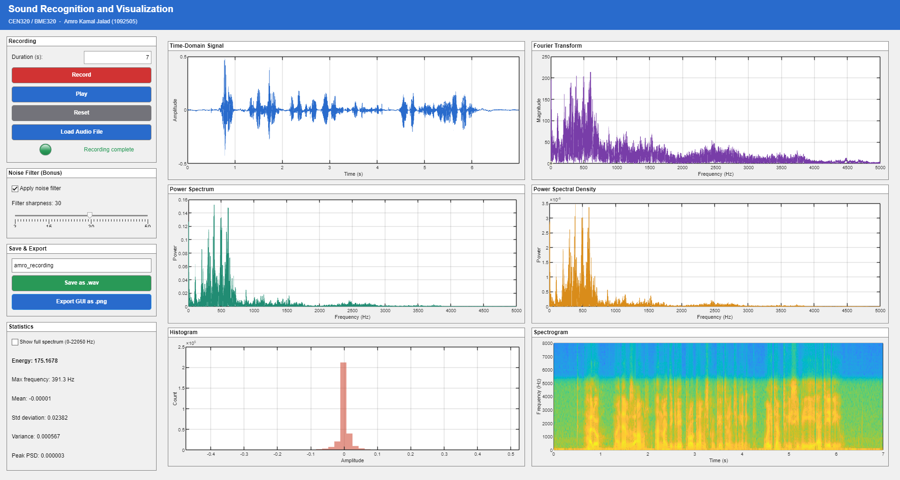
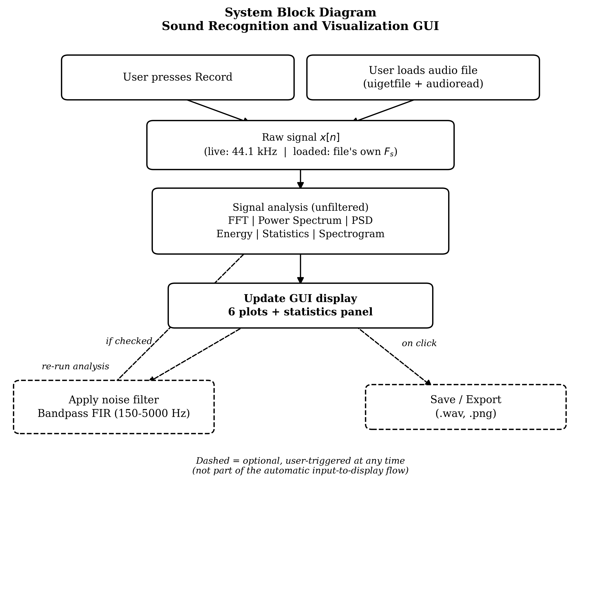
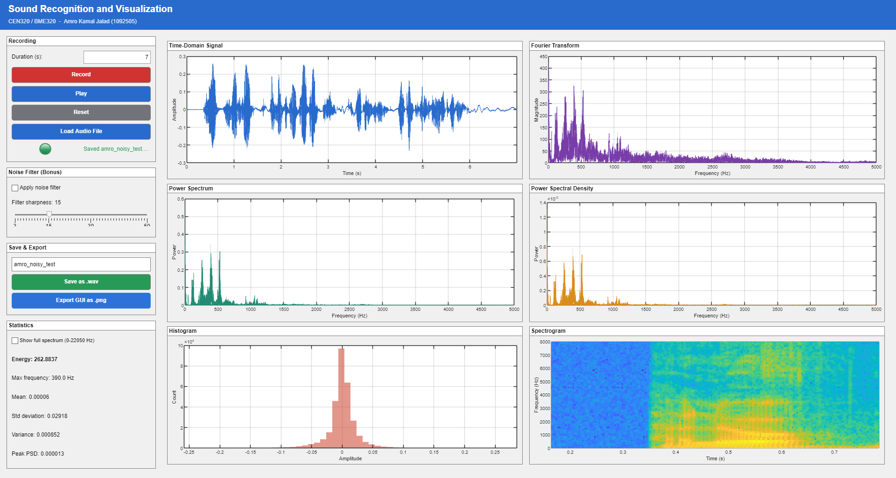
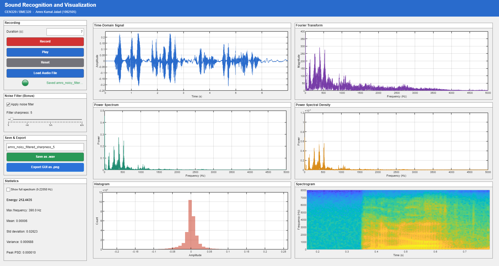
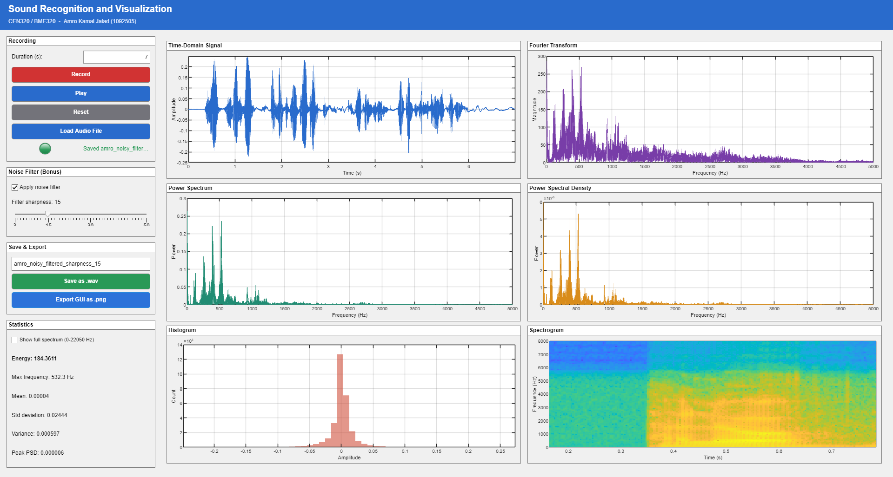
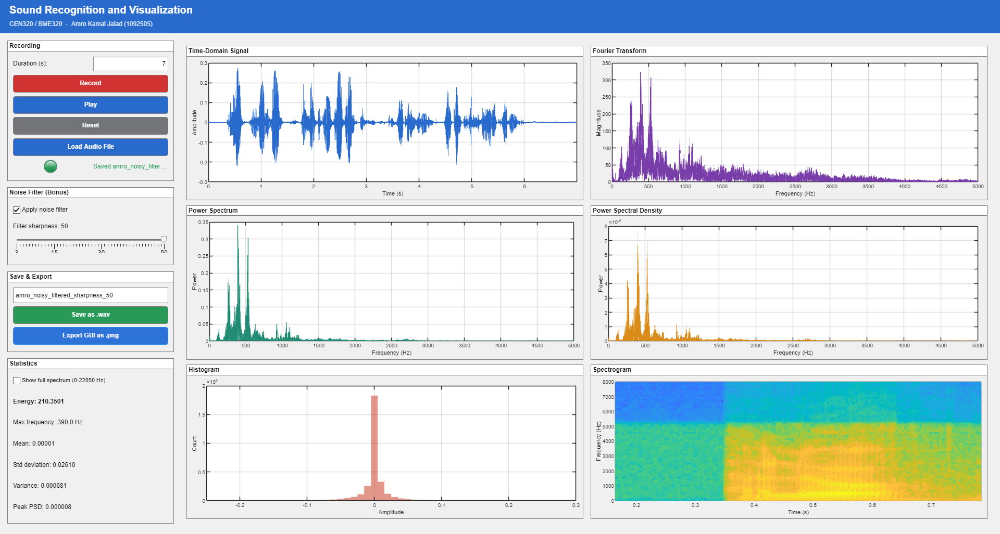
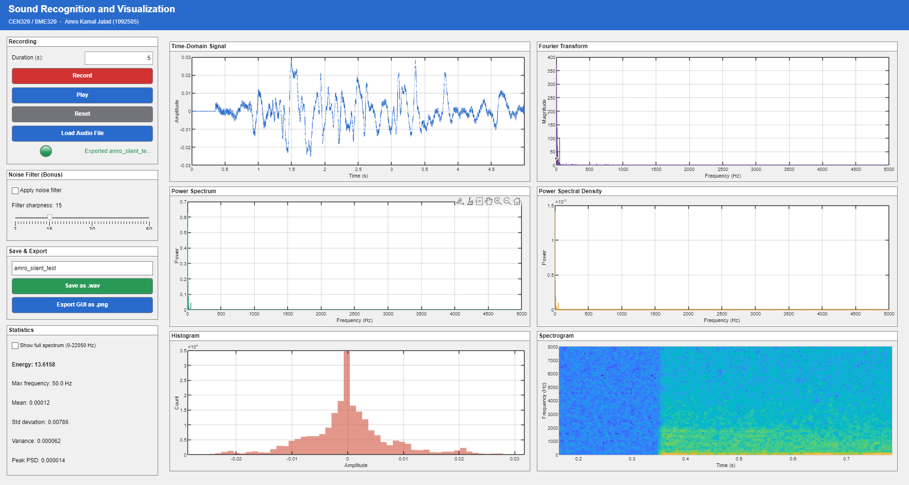

# Sound Recognition and Visualization

A MATLAB app that records your voice (or loads an audio file) and shows how the sound looks in time and frequency: waveform, Fourier transform, power spectrum, power spectral density, histogram and spectrogram, plus key statistics. It also includes an optional noise filter built from scratch.

**Course:** CEN320 / BME320 — **Author:** Amro Kamal Jalad

🎥 **Video demo:** https://youtu.be/ODDEm2gRQgE
📄 **Full report:** [docs/Sound_Recognition_and_Visualization_System_Report.pdf](docs/Sound_Recognition_and_Visualization_System_Report.pdf)



---

## Features

- **Record** a voice message (1–30 seconds, 44.1 kHz, mono) or **load** an existing audio file (`.wav`, `.mp3`, `.m4a`, `.flac`)
- **Six live plots:**
  - Time-domain signal
  - Fourier transform (magnitude spectrum)
  - Power spectrum
  - Power spectral density (PSD)
  - Amplitude histogram
  - Spectrogram (frequency content over time, in dB)
- **Statistics panel:** energy, dominant (max) frequency, mean, standard deviation, variance and peak PSD
- **Noise filter (bonus):** a 150–5000 Hz band-pass FIR filter with an adjustable sharpness slider; the plots update live as you move it
- **Playback** of the original or filtered audio
- **Save** the current signal as a `.wav` file and **export** the whole GUI as a `.png`
- Toggle between a speech-focused view (0–5000 Hz) and the full spectrum (0–22050 Hz)
- **No toolboxes needed:** runs on base MATLAB. The Hann/Hamming windows, sinc function and filter are all written by hand.

## How it works



| File | What it does |
|---|---|
| [`src/soundRecognitionGUI.m`](src/soundRecognitionGUI.m) | Builds the interface and connects the buttons to actions |
| [`src/analyzeSignal.m`](src/analyzeSignal.m) | All the math: FFT, power spectrum, PSD, energy, statistics, spectrogram. It has no GUI code, so you can also call it from the command window. |
| [`src/filterNoise.m`](src/filterNoise.m) | Windowed-sinc FIR band-pass filter (150–5000 Hz) built with `conv`, `sin` and `cos` only |

### Noise filter design

The cutoffs were picked after testing two extremes:

- **300–3400 Hz** (telephone band) cleaned the signal, but the voice sounded thin and tinny.
- **80–8000 Hz** was so close to the full voice range that it had almost no audible effect.
- **150–5000 Hz** removes low hum and high hiss while keeping the voice natural.

The sharpness slider (3–50) maps to filter order `6·v + 1`, which gives roughly 19–301 taps. Higher sharpness gives a cleaner cutoff.

## Running it

1. Open MATLAB (R2020b or newer is recommended for `uifigure` and `exportapp`).
2. Add the `src` folder to the path, or `cd` into it.
3. Run:

   ```matlab
   soundRecognitionGUI
   ```

To use the analysis on its own:

```matlab
[sig, Fs] = audioread('audio/amro_noisy_test.wav');
r = analyzeSignal(sig, Fs);
r.maxFreq   % dominant frequency in Hz
```

## Results

### Effect of filter sharpness on a noisy recording

| No filter | Sharpness 5 |
|---|---|
|  |  |
| **Sharpness 15** | **Sharpness 35** |
|  |  |
| **Sharpness 50** | |
|  | |

With the filter on, energy drops from 262.9 (unfiltered) to about 184–212 as noise outside the voice band is removed. As sharpness goes up, the spectrogram shows a cleaner cut above 5000 Hz.

### Other tests

| Clean recording (filter at 30) | Near-silent recording |
|---|---|
|  |  |

The silent test confirms that the analysis behaves sensibly with almost no signal. Energy is only 13.6, and nearly all the spectral content sits at very low frequencies.

## Repository layout

```
├── src/           MATLAB source code
├── audio/         Sample recordings (raw and filtered .wav)
├── screenshots/   GUI exports for each test
└── docs/          Project report and system diagram
```
